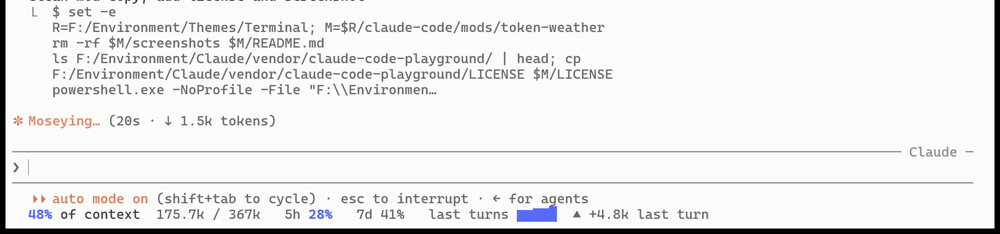

# Terminal: Claude Cream

A light, warm color setup for Claude Code in Windows Terminal, plus a context-usage mod under the prompt.



## Palette

| Role | Color |
| --- | --- |
| Terminal background, active tab | `#FBFBF9` |
| Tab row, user-message background | `#EDECE8` |
| Claude orange (`auto mode on`, warnings) | `#DA7756` |
| Blue (under 50% used, chart) | Claude Code light theme `permission`, `#5769F7` |
| Orange (50–80% used) | `#DA7756` |
| Red (80% and up) | `#FF5F57` |

## Contents

```
claude-code/
  themes/claude-cream.json        Claude Code custom theme (light base)
  mods/token-weather/             mod: context / 5h / 7d usage under the prompt
windows-terminal/
  claude-cream.json               color scheme + window theme to merge into WT settings
```

## Install

**Claude Code theme.** Copy `claude-code/themes/claude-cream.json` to `~/.claude/themes/`, then pick it in `/theme`, or set this in `~/.claude/settings.json`:

```json
"theme": "custom:claude-cream"
```

**Windows Terminal.** Open its `settings.json`, add the entries from `windows-terminal/claude-cream.json` to `schemes` and `themes`, then set `"theme": "Claude Cream"` and `profiles.defaults.colorScheme` to `"Claude Cream"`.

**Mod.** Put `claude-code/mods/token-weather` somewhere permanent and list it in `~/.claude/settings.json`:

```json
"env": { "CLAUDE_CODE_PLUGIN_DIRS": "C:\\path\\to\\token-weather" }
```

The mod shows one line under the prompt:

```
48% of context  175.7k / 367k   5h 28%   7d 41%   last turns ▃▅▇█  ▲ +4.8k last turn
```

- The percent is measured against the auto-compact threshold, so 100% means compaction is due.
- The context and `5h` figures are colored blue, orange or red by how much is used.
- During a compaction the line shows elapsed time and the summary's streamed size instead.

The mod is a fork of Anthropic's [Token Weather](https://github.com/anthropics/claude-code-playground) example (Apache-2.0, see `LICENSE`). Local changes are marked `// [local]`. It was built against Claude Code 2.1.296.
